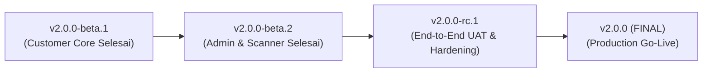

# Panduan Versioning & Release Management — Sinemus Platform v2

Dokumen ini adalah acuan standar baku bagi seluruh tim developer mengenai cara penomoran versi (**Semantic Versioning 2.0.0**), manajemen branch Git, serta alur rilis dari staging hingga ke production.

---

## 1. Struktur Format Semantic Versioning (SemVer)

Setiap nomor versi mengikuti pola standar:

$$\text{MAJOR} . \text{MINOR} . \text{PATCH} \ [- \text{PRERELEASE}]$$

Contoh: `v2.0.0-beta.1`, `v2.0.0`, `v2.1.0`, `v2.1.1`

| Komponen | Kapan Angka Berubah? | Contoh Kasus Nyata di Sinemus |
| :--- | :--- | :--- |
| **MAJOR (`X.0.0`)** | Terjadi perubahan arsitektur besar atau *breaking changes* yang tidak kompatibel ke belakang. | Rombak total dari Sinemus Platform v1 ke **Sinemus Platform v2** (Cloudflare Stream, Google-only OAuth, Monorepo baru). |
| **MINOR (`2.X.0`)** | Penambahan **fitur baru** (*backward-compatible*) yang tidak merusak fitur lama. | Penambahan fitur baru pasca-rilis: *Fitur Flash Sale Promo*, *Fitur WhatsApp Notification Bot*, *Sistem Loyalty Point*. |
| **PATCH (`2.1.X`)** | **Perbaikan bug (*bugfix*)**, *hotfix*, atau penyesuaian styling UI kecil tanpa menambah fitur baru. | Memperbaiki tombol modal yang macet di iOS, memperbaiki typo teks voucher, optimasi query lambat. |
| **PRE-RELEASE (`-beta.X`, `-rc.X`)** | Tahap pengujian di lingkungan **Staging / UAT** sebelum sistem resmi diluncurkan (*Go-Live*). | `2.0.0-beta.1` (Customer selesai), `2.0.0-rc.1` (Customer + Admin selesai untuk UAT). |

---

## 2. Roadmap Milestone Menuju Production (Peluncuran Awal v2)

Sebelum rilis publik pertama (`v2.0.0` GA), gunakan penomoran *Pre-Release* agar status kesiapan sistem terukur:



| Milestone Versi | Status | Cakupan Fitur |
| :--- | :--- | :--- |
| **`v2.0.0-beta.1`** | **Tercapai (Staging)** | Modul Customer selesai: Auth Google-only, Screening (Event & VoD Cloudflare), Checkout Midtrans (15m lock), My Tickets & QR Presale Lifecycle. |
| **`v2.0.0-beta.2`** | **Tercapai (Staging)** | Modul Admin Studio & Venue Scanner terintegrasi: CRUD Master Data Event/Film, Layout Generator, Dashboard Transaksi/Laporan, Injeksi Tiket, Banner, Voucher, dan Mobile Gate QR Scanner. |
| **`v2.0.0-rc.1`** | **Tahap Berikutnya** | Release Candidate: End-to-end UAT, Staging load testing, dan Penetration testing. |
| **`v2.0.0`** | **Production Go-Live** | Peluncuran resmi Sinemus Platform v2 ke publik setelah lolos UAT end-to-end dan audit keamanan. |

---

## 3. Siklus Versioning Pasca-Peluncuran (Live Production)

Setelah versi `v2.0.0` resmi beroperasi di production, ikuti aturan bump versi berikut:

```
v2.0.0 (Rilis Awal)
 ├── Ditemukan bug di modal tiket ────────► v2.0.1 (Patch Bugfix)
 ├── Ada typo dan perbaikan style UI ────► v2.0.2 (Patch Bugfix)
 ├── Rilis Fitur Baru: "Sistem Voucher" ─► v2.1.0 (Minor Feature)
 │    └── Perbaikan bug pada voucher ────► v2.1.1 (Patch Bugfix)
 └── Rilis Fitur Baru: "Affiliate Link" ─► v2.2.0 (Minor Feature)
```

---

## 4. Alur Kerja Git & Rilis (Git Workflow Standard)

### A. Aturan Branching
1. **`main`**: Kode produksi live (`Production`). Hanya diisi lewat PR dari `staging` saat rilis versi stabil.
2. **`staging`**: Integrasi pengujian seluruh fitur (`UAT / Staging Environment`).
3. **`feat/...` / `refactor/...` / `fix/...`**: Branch pengerjaan fitur per domain (misal: `feat/admin-studio`).

### B. Prosedur Rilis & Tagging Versi Baru

Setiap kali sebuah milestone selesai dan siap diuji:

1. **Perbarui Versi di Codebase:**
   * Frontend ([frontend/package.json](file:///d:/Projects/sinemus-platform/frontend/package.json)):
     ```json
     "version": "2.X.X"
     ```
   * Backend ([backend/composer.json](file:///d:/Projects/sinemus-platform/backend/composer.json) & [backend/.env.example](file:///d:/Projects/sinemus-platform/backend/.env.example)):
     ```json
     "version": "2.X.X"
     ```
     ```env
     APP_VERSION=2.X.X
     ```

2. **Catat Perubahan di `CHANGELOG.md`:**
   Tambahkan blok rilis baru di bagian teratas [CHANGELOG.md](file:///d:/Projects/sinemus-platform/CHANGELOG.md) mengikuti format *Keep a Changelog* (`Added`, `Changed`, `Fixed`, `Security`).

3. **Jalankan Verifikasi Kualitas (Quality Gate):**
   ```bash
   # Di folder frontend
   npm run format:check && npm run type-check && npm run lint

   # Di folder backend
   vendor/bin/pint --test && php artisan route:list
   ```

4. **Commit & Buat Annotated Git Tag:**
   ```bash
   git add -A
   git commit -m "chore(release): bump version to v2.X.X"
   git tag -a v2.X.X -m "Sinemus Platform v2: [Ringkasan Rilis]"
   ```

5. **Push ke Remote GitHub:**
   ```bash
   git push origin staging
   git push origin v2.X.X
   ```

---

## 5. Ringkasan Singkat (Cheat Sheet)

* **Apakah sedang nambah fitur baru di production?** $\rightarrow$ Naikkan angka tengah (**MINOR**): `2.0.0` $\rightarrow$ `2.1.0`.
* **Apakah sedang benerin bug / tweak UI di production?** $\rightarrow$ Naikkan angka belakang (**PATCH**): `2.1.0` $\rightarrow$ `2.1.1`.
* **Apakah masih proses integrasi sebelum launching?** $\rightarrow$ Gunakan akhiran (**PRE-RELEASE**): `2.0.0-beta.1` $\rightarrow$ `2.0.0-rc.1` $\rightarrow$ `2.0.0`.